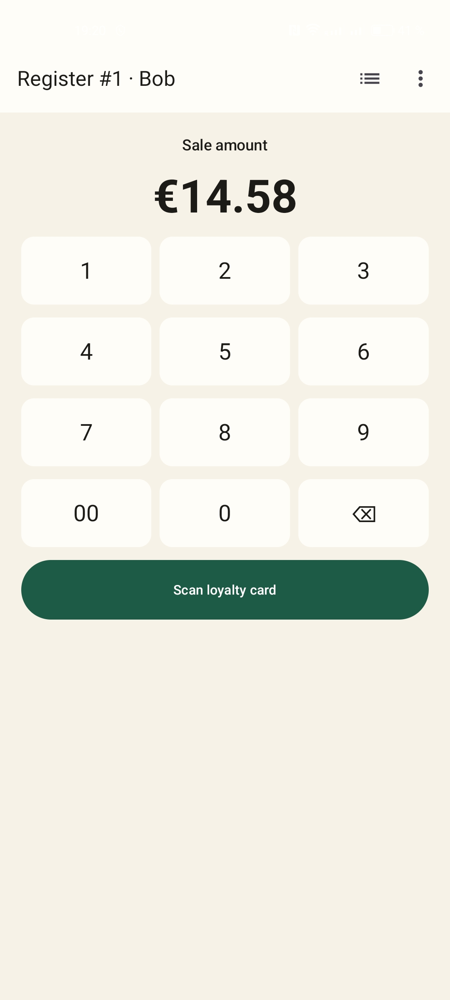
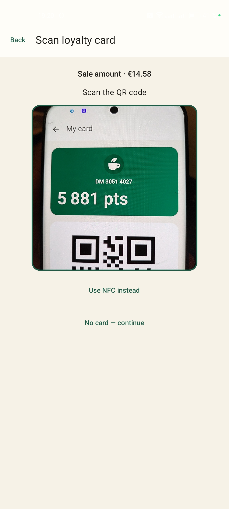
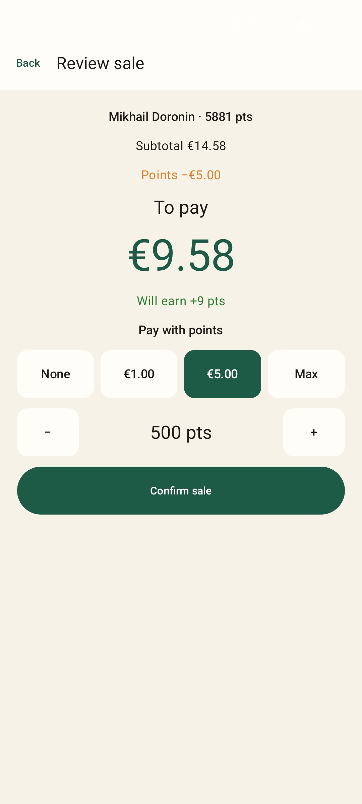
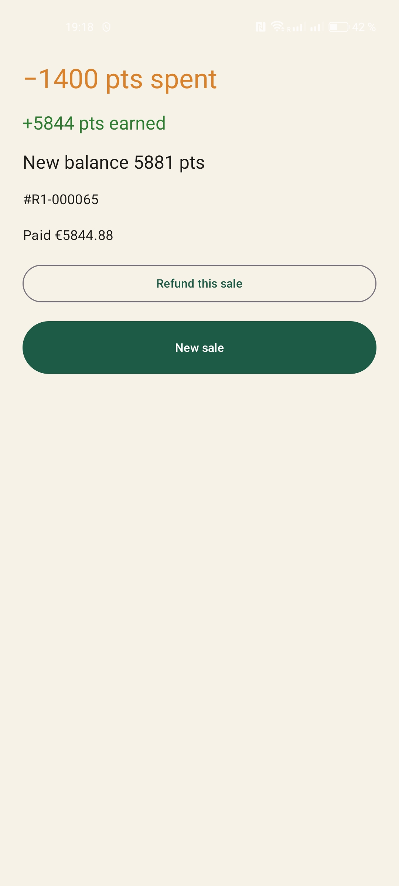
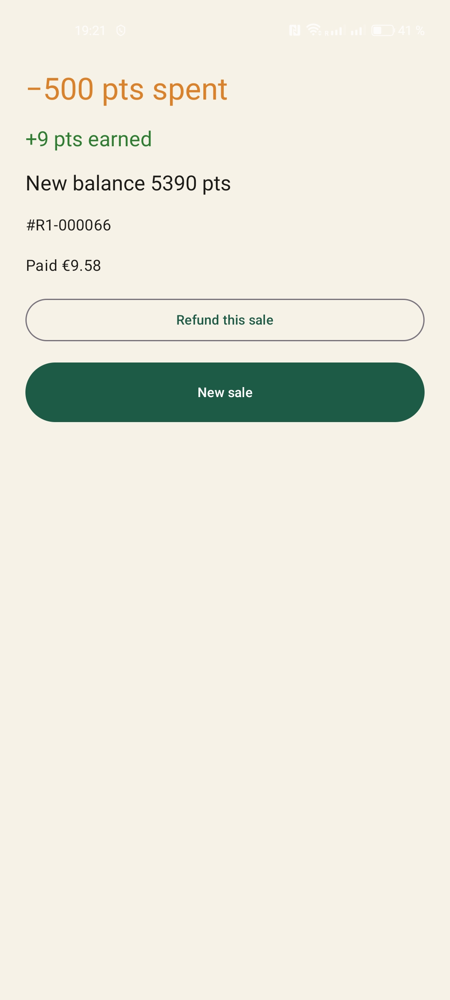
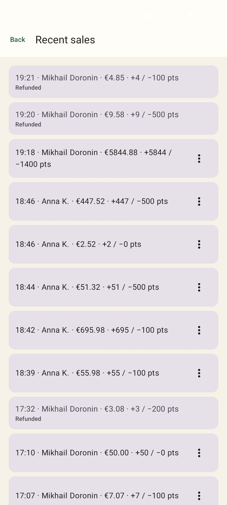
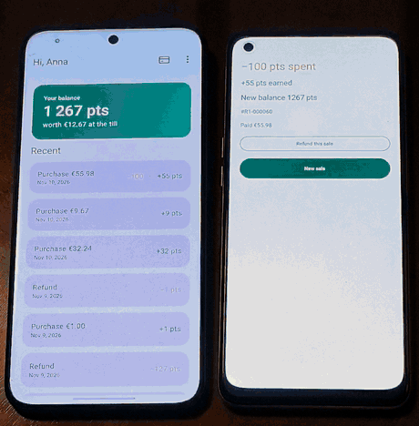
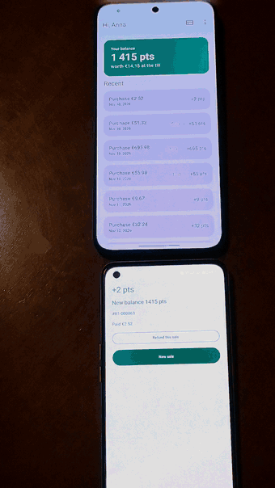

<p align="center"></p>

<h1 align="center">DemoMart Register</h1>

<p align="center">Part of <a href="https://github.com/DoroninMA/demomart"><b>DemoMart</b></a>, a demo loyalty card system</p>

Demo cash register for Android. The cashier enters an amount, reads the customer's loyalty card over NFC (DemoMart app or Google Wallet via Smart Tap) or by QR, redeems points and commits the sale. Recent sales can be refunded.

Kotlin, Jetpack Compose, Hilt, Retrofit, CameraX + ML Kit.

## Screenshots

<p align="center">






</p>

## Build

JDK 17+, Android SDK 37.

```powershell
.\gradlew.bat :app:testDebugUnitTest :app:assembleDebug
```

## Run against a local server

Start `demomart-server` (see its README) with `AUTH_MODE=fake` and seed it.

- Emulator: works out of the box, the debug build uses `http://10.0.2.2:8000/`.
- Phone over USB: `adb reverse tcp:8000 tcp:8000` and add `loyalty.serverUrl=http://127.0.0.1:8000/` to `local.properties`.

Install with `.\gradlew.bat :app:installDebug`, tap **Demo cashier (Bob)** and sign in with an empty password.

NFC is the default on the scan screen; **Scan QR code** opens the camera. Both can't run at once, some phones stop NFC polling while the camera is on. Debug builds also have a **Paste code** field.

## Configuration (`local.properties`)

| Key | |
|---|---|
| `loyalty.serverUrl` | debug server URL |
| `loyalty.releaseServerUrl` | release server URL, must be https |
| `loyalty.smartTap.collectorId` | Smart Tap collector ID, `0` disables Smart Tap |
| `loyalty.smartTap.keyVersion` | Smart Tap key version |
| `loyalty.smartTap.keyFile` | PEM private key of the terminal (keep it out of git) |

`-Ployalty.authMode=firebase` switches a debug build to Firebase sign-in; it needs `app/google-services.json`. Release builds always use Firebase.

## Smart Tap

The Smart Tap reader (`smarttap/`) is a Kotlin port of Google's Smart Tap sample app, Apache License 2.0. See `NOTICE` and `LICENSES/`.

## Demo

| Pay over NFC | Pay by QR |
|---|---|
|  |  |

## License

MIT, see `LICENSE`.
